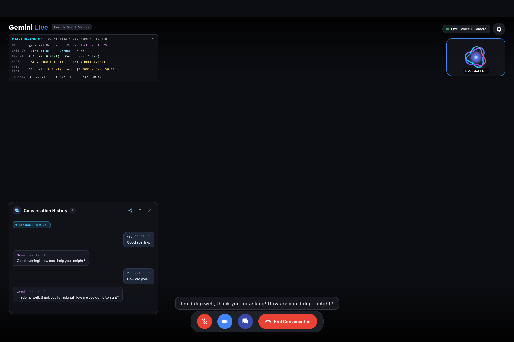
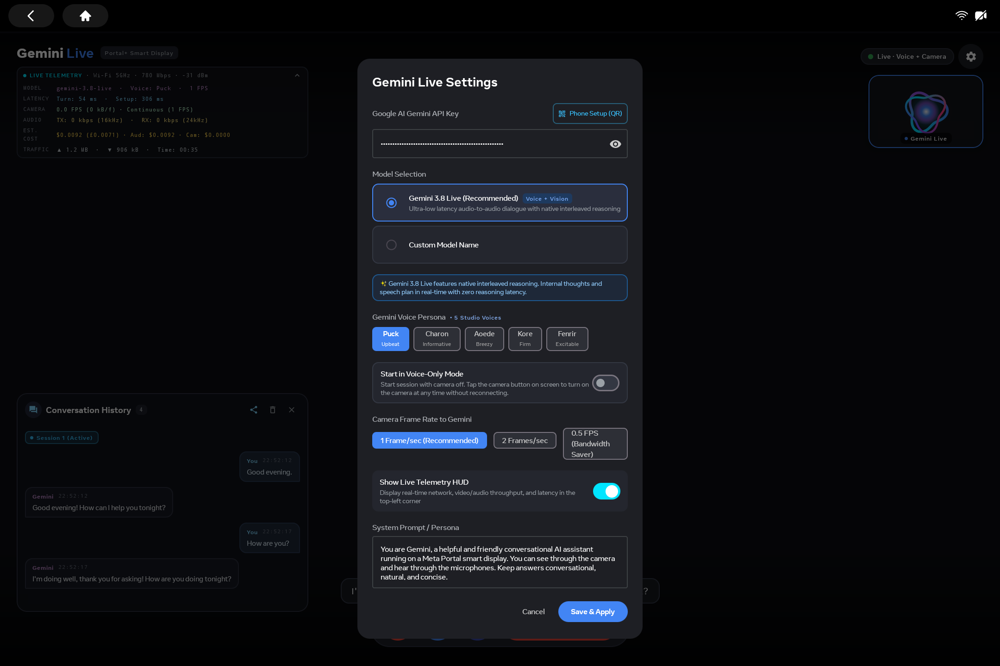

# Portal Gemini Live

[](https://github.com/pgodlews/portal-gemini-live/actions/workflows/android.yml)

An unofficial Android client for real-time voice and camera conversations with Google's Gemini Live API, built for Meta Portal smart displays. Developed on a Meta Portal+ Gen 2 running Android 10.

## Screenshots

### Live conversation

Conversation history, live subtitles, and session telemetry on Meta Portal.



### Settings

Model, voice, camera frame rate, and system prompt settings. The API key is hidden.



## Features

- Voice conversations with interruption support and live subtitles.
- Camera2 preview and optional camera streaming at 0.5, 1, or 2 FPS.
- Voice-only mode, microphone mute, and automatic camera pause.
- Conversation history and local QR-based transcript export.
- On-device settings and QR-based phone setup.
- Network, latency, throughput, and approximate cost telemetry.

This is a community project and is not affiliated with Google or Meta. You need your own Gemini API key and access to a compatible Live API model. API usage may incur charges. The built-in cost display uses fixed estimates, not billing data.

## Build

Requirements:

- JDK 17, available through `JAVA_HOME` or `PATH`.
- Android SDK with platform API 35 and the build tools requested by Gradle.
- Android SDK platform-tools (`adb`) for installation.
- An Android device with API 28 or later; Portal-specific camera and audio behavior may differ on other devices.

Set the SDK location using `ANDROID_HOME` or an untracked `local.properties` file:

```properties
sdk.dir=/path/to/Android/sdk
```

Build from source using the included Gradle wrapper:

```bash
./gradlew assembleDebug
```

The APK is written to `app/build/outputs/apk/debug/app-debug.apk`. No API key is needed to build. Generated binaries, local settings, and signing keys are excluded from Git.

## Automated checks

[GitHub Actions](https://github.com/pgodlews/portal-gemini-live/actions/workflows/android.yml) scans source for secrets, validates the Gradle wrapper, builds the debug APK, and runs Android lint on pushes and pull requests. It can also be started manually. Successful runs provide a debug APK artifact; lint reports are retained when available. Artifacts expire after seven days. No Gemini API key or signing secret is required.

## Install and configure

Enable ADB on your device, connect it, and confirm it appears in `adb devices`. Then run:

```bash
adb install -r -g app/build/outputs/apk/debug/app-debug.apk
adb shell am start -n dev.portalgemini/.MainActivity
```

Alternatively, `./scripts/install.sh` builds, copies the debug APK to `dist/`, installs it, and launches the app. Keep only the intended device connected when using that script.

1. Open **Settings** on the Portal and enter your own key from [Google AI Studio](https://aistudio.google.com/).
2. Choose a model and voice available to your account. The current source defaults to `models/gemini-3.8-live`; availability is not guaranteed, and Settings supports a custom model ID.
3. Choose whether to start in voice-only mode, then tap **Start Gemini Live**.
4. Open conversation history to export a transcript when needed.

Phone setup opens automatically when no key is configured and can also be opened from Settings. It uses a temporary HTTP server on the local network, protected by a random token in the QR link. Use it only on a trusted private network: HTTP does not encrypt the key in transit. Entering the key directly in Settings avoids this local network transfer. Close the dialog when finished, and treat setup/export QR codes as private.

## Privacy and security

The key and settings are stored in the app's private `SharedPreferences`, without additional application-level encryption. Android app backup is disabled. The repository contains no configured key. The app connects directly to Google over TLS for live sessions; active audio and enabled camera frames leave the device. Microphone mute stops audio transmission but keeps local capture running for the visualizer. Pausing camera transmission leaves the local preview active.

Transcript exports and diagnostics can contain personal information. Do not attach real conversations, setup QR codes, keys, device backups, or unreviewed screenshots to public issues. See [SECURITY.md](SECURITY.md) for limitations and reporting guidance.

## Source layout

- `app/src/main/java/dev/portalgemini/` — activity, audio, camera, API client, local HTTP server, telemetry, and Compose UI.
- `app/src/main/res/` — Android resources.
- `docs/ARCHITECTURE.md` — component and data-flow overview.

## License

Copyright (c) 2026 Piotr Godlewski.

[MIT](LICENSE). Third-party dependencies and the Gradle wrapper retain their respective licenses.
