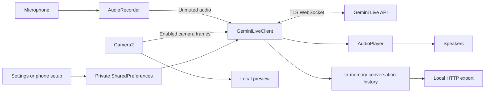

# Architecture

## Components

| Component | Responsibility |
|---|---|
| `MainActivity` | Permissions, preferences, session lifecycle, UI state, and local setup/export server lifecycle |
| `GeminiLiveClient` | Gemini Live WebSocket setup, audio/video messages, transcripts, and interruption callbacks |
| `AudioRecorder` | 16 kHz mono PCM capture, supported audio effects, mute gating, and local amplitude |
| `AudioPlayer` | Queued 24 kHz mono PCM playback and interruption flushing |
| `PortalCameraManager` | Camera2 preview, JPEG encoding, frame pacing, and camera mode |
| `PortalHttpServer` | Token-protected local HTTP setup and transcript downloads |
| `TelemetryManager` | Rolling throughput, latency, network information, and fixed cost estimates |
| Compose UI | Settings, camera preview, animated orb, telemetry, subtitles, and history |

Source files are under `app/src/main/java/dev/portalgemini/`.

## Data flow

The client uses the `v1alpha` `BidiGenerateContent` endpoint. The API key is a query parameter on the TLS WebSocket request. The setup message selects audio responses, a voice and model, transcription, and an optional system prompt. Both text and binary WebSocket frames are decoded as JSON.

Audio and camera sends are gated on the connected state. Muting audio stops transmission but retains local capture for amplitude visualization. Camera standby stops frame transmission while retaining the local preview. Incoming interruption events flush playback. Transcript state remains in memory until exported or cleared.

## Configuration and privacy

Settings are persisted in `gemini_prefs` using private Android `SharedPreferences`. The key is supplied at runtime and is not included in the build. Android app backup is disabled. The local setup page does not prefill the stored key.

Setup and export use separate instances of the local HTTP server. Each instance gets a full random UUID token, required in the request URL. Responses include `Cache-Control: no-store` and `Referrer-Policy: no-referrer`. The connection is plain HTTP, so this feature requires a trusted private network. See [security guidance](../SECURITY.md).

Diagnostics omit key fragments, tokens, prompts, transcript text, raw protocol messages, and raw connection errors. Generic connection errors retain an HTTP status when available.

## Platform considerations

The app uses Camera2 directly for Portal camera compatibility. CameraX dependencies remain in the build but are not the active capture path. The app targets Android API 29 and compiles against API 35; behavior on other firmware and devices needs device testing.

Microphone capture and local HTTP requests use IO coroutines. Camera callbacks and JPEG encoding use a background handler thread. WebSocket callbacks update flows and invoke audio/transcript callbacks. Audio playback uses a queue that is currently unbounded. Hardware echo cancellation depends on device support.
